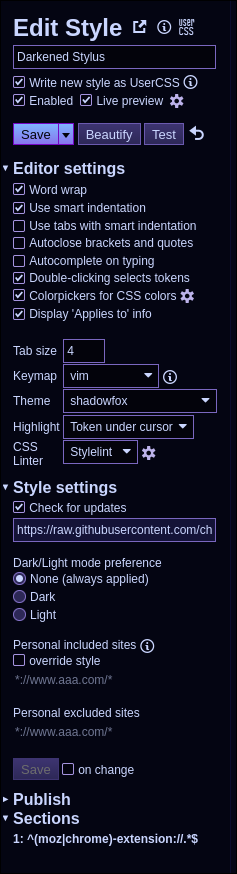
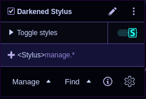
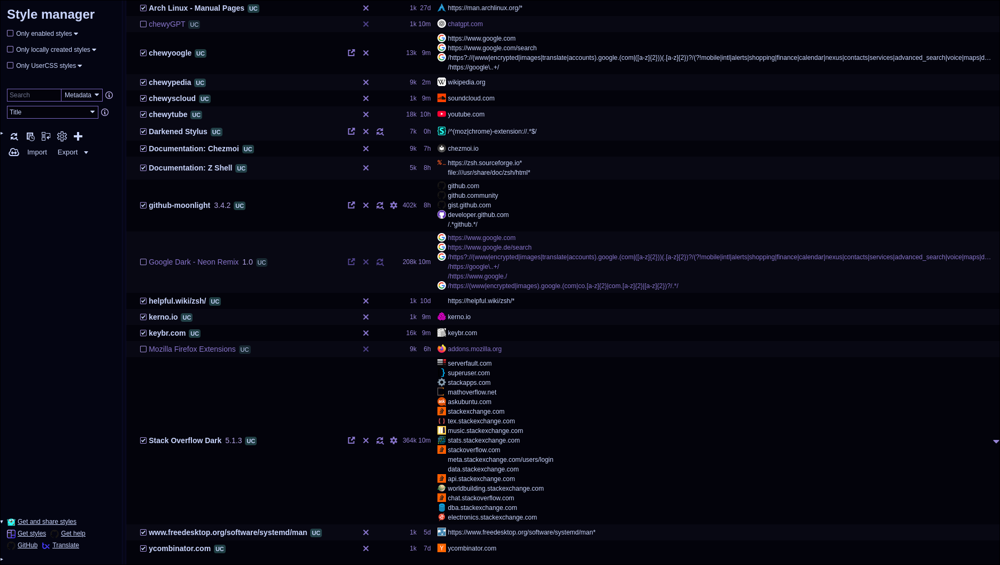

<!--
   -
   - ~chewygumxx/userstyle.git
   - ::: :/doc/darkened-stylus.md
   -
   -->

# darkened-stylus

Styleyou, Styleme, Stylus ^-^

[![badge][]][ucss-darkened-stylus] 

[badge]: <https://img.shields.io/badge/Install%20directly%20with-Stylus-00adad.svg>
[ucss-darkened-stylus]:  <../../../raw/main/style/darkened-stylus.user.css>

## Screenshots 

<table>
  <tr>
    <td rowspan="2" width="180px"></td>
    <td></td>
  </tr>
  <tr><td></td></tr>
</table>

<!-- vim:set expandtab shiftwidth=2 filetype=markdown foldlevel=3: -->
